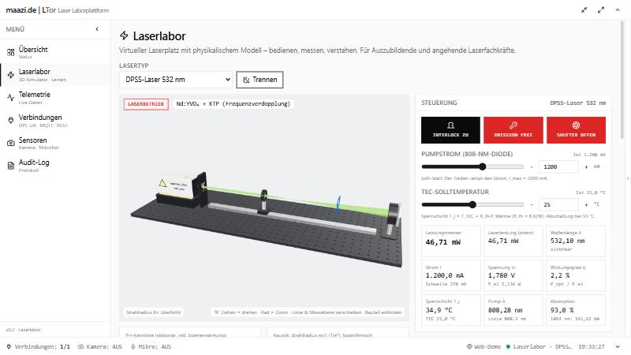

# maazi.de | LTor — Laser Tor

**Universelle Laborplattform für Lasersysteme & optische Messtechnik.**

LTor ist eine industriell gestaltete Desktop-Anwendung (Electron + React +
TypeScript), die heterogene Laborhardware – SPSen, Sensoren, Messgeräte – über
**OPC UA**, **MQTT** und **REST** in einer einheitlichen Oberfläche
zusammenführt, Telemetrie live darstellt, Kamera- und Mikrofon-Signale der
Workstation einbindet und alle sicherheitsrelevanten Vorgänge in einem
manipulationssicheren **Audit-Log** protokolliert.

Das Frontend ist **transport-agnostisch** aufgebaut: derselbe React-Code läuft
sowohl in der Electron-Desktop-App (lokal, direkt am Labor-PC) als auch im
Webbrowser gegen einen Remote-Backend-Server (z. B. VPS) – siehe Abschnitt
[Deployment-Varianten](#deployment-varianten).

> ### 🟢 Neu in v0.2: das Laserlabor – jetzt live im Browser testen
>
> **[ltor.maazi.de](https://ltor.maazi.de)** · ohne Installation, ohne Anmeldung
>
> Ein virtueller Laserplatz mit **3D-Optikbank** und **physikalischem Modell**:
> fünf Lasertypen (405 nm GaN-Diode, 808 nm Hochleistungsdiode, 1550 nm DFB,
> 1064 nm und 532 nm DPSS) mit Schwellstrom nach T₀-Gesetz, Eigenerwärmung,
> Wellenlängendrift, Pumpabsorption und quadratischer Frequenzverdopplung.
> Linse und Messebene lassen sich im 3D-Bild verschieben – Kaustik und
> Strahlprofil folgen dem Gaußstrahl-Formalismus (ABCD/q-Parameter).
> Laserklasse, MPE, NOHD und Schutzbrillen-OD werden live berechnet.
> Für **Auszubildende und angehende Laserfachkräfte** erklärt das Labor jeden
> Zustand, prüft sieben Übungen automatisch und protokolliert jeden Schritt.
> Details: [Laserlabor](#laserlabor-neu-in-v02).

[](https://ltor.maazi.de)

---

[](/media/1-5_LTor.gif)

---

## Inhalt

- [Auf einen Blick](#auf-einen-blick)
- [Für Anwender:innen](#für-anwenderinnen)
  - [Installation](#installation)
  - [Erster Start](#erster-start)
  - [Module der Oberfläche](#module-der-oberfläche)
  - [Laserlabor (neu in v0.2)](#laserlabor-neu-in-v02)
  - [Konfiguration pro Protokoll](#konfiguration-pro-protokoll)
  - [Tastaturbedienung & Bedienkonzept](#tastaturbedienung--bedienkonzept)
  - [Wo werden meine Daten gespeichert?](#wo-werden-meine-daten-gespeichert)
  - [Häufige Probleme](#häufige-probleme)
- [Für Entwickler:innen](#für-entwicklerinnen)
  - [Tech-Stack](#tech-stack)
  - [Projektstruktur](#projektstruktur)
  - [Voraussetzungen](#voraussetzungen)
  - [Setup & Skripte](#setup--skripte)
  - [Architekturüberblick](#architekturüberblick)
  - [IPC-Layer (Electron ↔ WebSocket)](#ipc-layer-electron--websocket)
  - [Eigenen Protokoll-Adapter schreiben](#eigenen-protokoll-adapter-schreiben)
  - [Neues UI-Modul anlegen](#neues-ui-modul-anlegen)
  - [Audit-Log: Format & Erweiterung](#audit-log-format--erweiterung)
  - [Deployment-Varianten](#deployment-varianten)
  - [Online-Demo auf einem VPS (Plesk)](#online-demo-auf-einem-vps-plesk)
  - [Roadmap](#roadmap)
- [Lizenz](#lizenz)

---

## Auf einen Blick

| Bereich    | Kern                                                                   |
| ---------- | ---------------------------------------------------------------------- |
| Plattform  | Windows / macOS / Linux (Electron)                                     |
| Protokolle | OPC UA (`node-opcua`), MQTT (`mqtt.js`), REST (`axios`), Laser-Simulator |
| Laserlabor | 3D-Optikbank (three.js, Blender-Modell), Laserphysik, Laserschutz, Übungen |
| Sensoren   | Kamera & Mikrofon der Workstation (Web `MediaDevices` API)             |
| UI         | React + TypeScript + TailwindCSS, einklappbare Panels, modul-basiert   |
| Persistenz | Verbindungen → `connections.json`, Audit-Log → `audit.jsonl`           |
| Audit-Log  | Append-only JSON Lines, lückenlos, exportierbar                        |
| Transport  | Lokal: Electron-IPC (`window.ltor`) · Remote-fähig: WebSocket-JSON-RPC |

---

# Für Anwender:innen

## Installation

Aktuell liegt die App im Quellzustand vor; Binaries werden in einem späteren
Release-Schritt via `electron-builder` paketiert.

Lokal starten:

```bash
git clone <repo-url> LTor
cd LTor
npm install
npm run dev          # öffnet das Electron-Fenster
```

> **Hinweis:** `npm run dev` öffnet automatisch das Electron-Fenster. Daneben
> startet ein Vite-Dev-Server unter `http://localhost:5173/` – das ist nur ein
> Asset-Server für den Renderer und in dieser Konfiguration **nicht** zur
> direkten Browser-Benutzung gedacht (außer du betreibst zusätzlich ein
> Backend, siehe [Deployment-Varianten](#deployment-varianten)).

## Erster Start

Beim allerersten Start ist die Verbindungsliste leer. Empfohlener Ablauf:

1. **Sidebar → Verbindungen** öffnen.
2. Protokolltyp wählen (OPC UA / MQTT / REST), auf **Neu** klicken.
3. Formular ausfüllen (siehe [Konfiguration pro Protokoll](#konfiguration-pro-protokoll))
   und speichern.
4. In der Tabelle bei der Verbindung auf **Verbinden** klicken.
5. **Telemetrie**-Modul öffnen → Live-Werte erscheinen als Sparklines.
6. **Sensoren** (Kamera/Mikrofon) und **Audit-Log** verhalten sich
   selbsterklärend.

## Module der Oberfläche

| Modul        | Inhalt                                                                                                           |
| ------------ | ---------------------------------------------------------------------------------------------------------------- |
| Übersicht    | Stat-Cards (verbundene Geräte, aktive Kanäle, Sensoren), kompakte Verbindungs-Status-Tabelle, jüngste Warnungen. |
| Laserlabor   | 3D-Laserplatz mit Simulator: Steuerung, P-I-Kennlinie, Kaustik, Strahlprofil, Laserschutz, Lernpfad & Protokoll. |
| Telemetrie   | Live-Sparklines pro Kanal, Werteanzeige, Min/Max/Last, Pause-Funktion, Filter & Verbindungs-Auswahl.             |
| Verbindungen | CRUD für Verbindungen, pro Verbindung Connect/Disconnect/Edit/Delete. Formular je Protokolltyp.                  |
| Sensoren     | Bordeigene Kamera (Vorschau) und Mikrofon (RMS-Pegelmeter). Auswahl des Geräts, Start/Stopp.                     |
| Audit-Log    | Tabelle aller Ereignisse, Filter nach Kategorie/Zeitraum/Volltext, JSONL-Export, kompletter Reset.               |

## Laserlabor (neu in v0.2)

Das Laserlabor ist ein virtueller Laserplatz. Hinter jedem Gerät steckt der
neue Verbindungstyp **`sim`** – ein Laser-Controller (Stromtreiber, TEC,
Schlüsselschalter, Shutter, Interlock), dessen Messwerte aus einem
physikalischen Modell (`src/shared/laserPhysics.ts`) stammen. Der Simulator
läuft im Backend wie jedes echte Gerät: Telemetrie, Schreibbefehle und
Audit-Log funktionieren genau wie bei OPC UA, MQTT oder REST.

**Bedienen**

- Interlock, Schlüsselschalter (Emission) und Shutter schalten; Diodenstrom
  und TEC-Temperatur über Regler oder exakte Eingabe setzen.
- Die Emission startet erst nach **3 s Emissionsverzögerung** (Warnleuchte am
  Laserkopf), der Strom wird per **Soft-Start** gerampt.
- Interlock öffnen schaltet die Emission sofort ab – **kein automatischer
  Wiederanlauf**. Übertemperatur der Sperrschicht löst eine
  Schutzabschaltung aus, die quittiert werden muss.
- Im 3D-Bild: ziehen = drehen, Rad = Zoom, **Linse und Messebene entlang der
  Schiene ziehen**, Bauteil anklicken = Erklärung (Funktion, Physik, Praxis).

**Physik (Lehrmodell, Formeln im Code dokumentiert)**

| Effekt                    | Modell                                                         |
| ------------------------- | -------------------------------------------------------------- |
| Schwellstrom              | I_th(T) = I_th,25 · exp((T − 25 °C)/T₀)                        |
| Ausgangsleistung (Diode)  | P = η(T)·(I − I_th), darunter spontane Emission                |
| Eigenerwärmung            | T_j = T_TEC + R_th·(U·I − P_opt), U = U₀ + R_s·I               |
| Wellenlänge               | λ(T) = λ₂₅ + dλ/dT·(T − 25 °C); DPSS: atomarer Übergang (fest) |
| DPSS-Pumpabsorption       | Lorentz-Linie Nd:YVO₄ bei 808,5 nm, FWHM 2,5 nm                |
| Frequenzverdopplung (SHG) | P₅₃₂ = k·P₁₀₆₄²                                                |
| Gaußstrahl                | z_R = π·w₀²/(M²·λ), w(z) = w₀·√(1 + (z/z_R)²)                  |
| Dünne Linse               | 1/q′ = 1/q − 1/f (komplexer Strahlparameter)                   |
| Laserschutz               | AEL/Klasse, MPE, NOHD, OD nach IEC 60825-1 (vereinfacht, CW)   |

`npm run test:physics` prüft die Formeln gegen Lehrbuchwerte.

**Lernen**

- **Was passiert?** – erklärt den aktuellen Zustand (unter/über der Schwelle,
  Shutter, Absorption, Temperaturgrenze …) in Klartext.
- **Übungen** – sieben Aufgaben, die automatisch erkannt werden: sicher
  einschalten, Laserschwelle finden, Temperatureinfluss, Pumpwellenlänge
  abstimmen (DPSS), fokussieren & vermessen, Laserklasse/Schutzbrille (Quiz),
  sicher ausschalten.
- **Protokoll** – jede Aktion und jede Gerätemeldung mit Erklärung; der
  Fortschritt landet zusätzlich im Audit-Log (exportierbar als JSONL).

> Die Sicherheitswerte sind vereinfachte Lehrwerte. Sie ersetzen keine
> Gefährdungsbeurteilung durch die/den Laserschutzbeauftragte:n (TROS
> Laserstrahlung).

Das 3D-Modell wird reproduzierbar per Skript in Blender erzeugt:

```bash
blender --background --factory-startup --python assets/blender/build_ltor_lab.py
# → assets/blender/ltor_lab.blend + src/renderer/src/assets/ltor_lab.glb
```

## Konfiguration pro Protokoll

### OPC UA

- **Endpoint:** `opc.tcp://host:4840`
- **Security Mode:** `None`, `Sign`, `SignAndEncrypt`
- **Security Policy:** `None`, `Basic256Sha256`, `Aes128_Sha256_RsaOaep`,
  `Aes256_Sha256_RsaPss`
- **Benutzer/Passwort:** optional; leer = anonymous.
- **Publishing-Intervall (ms):** Subscriptions-Default für alle Nodes.
- **Datenpunkte:** eine Zeile pro Node im Format

  ```
  nodeId|kanalName
  ```

  Beispiel:

  ```
  ns=2;s=Demo.Static.Scalar.Double|temperatur
  ns=2;s=Demo.Dynamic.Scalar.Int32|count
  ```

### MQTT

- **Broker-URL:** `mqtt://`, `mqtts://` oder `ws://…` (Web-MQTT).
- **Client-ID / Benutzer / Passwort:** optional.
- **Topics:** eine Zeile pro Subscription:

  ```
  topic|kanalName|qos
  ```

  Beispiel:

  ```
  lab/+/temperatur|temperatur|0
  factory/#|allgemein|1
  ```

  Wildcards `+` und `#` werden unterstützt.

### REST

- **Base-URL:** z. B. `http://gateway.local:8000`
- **Methode:** GET / POST / PUT / PATCH / DELETE
- **Header:** zeilenweise `Key: Value`.
- **Polling-Endpoints:** zeilenweise

  ```
  pfad|kanalName|intervallMs|jsonPath
  ```

  `jsonPath` ist optional und bedient eine kleine Dollar-Subset-Syntax
  (`$.path.to.value`); leer = ganze Response wird verwendet.

  Beispiel:

  ```
  /api/sensor|temperatur|1000|$.value
  /api/health|status|5000|
  ```

## Tastaturbedienung & Bedienkonzept

- Alle Seitenpanels (Titlebar, Sidebar, Tools-Panel, Statusbar) sind über die
  kleinen Chevron-Buttons **einzeln ein-/ausklappbar**. Eingeklappte Panels
  hinterlassen schmale Rand-Toggles, mit denen sie wieder geöffnet werden.
- **DevTools** öffnen sich **standardmäßig nicht**. Aktivierung wahlweise per:
  - Flag: `npm run dev -- -- --devtools`
  - Env-Variable: `LTOR_DEVTOOLS=1`
  - Tastenkürzel im Fenster: `F12` bzw. `Ctrl + Shift + I`

### Laser-Simulator (`sim`)

- **Lasermodell:** `diode405`, `dfb1550`, `diode808`, `dpss1064`, `dpss532`
- **Telemetrie-Rate:** 1 … 10 Hz, **Messrauschen:** 0 … 1
- **Schreibbare Kanäle** (`connections.write`): `current_set_mA`,
  `tec_set_C`, `emission`, `shutter`, `interlock`, `fault_reset`
- Öffnet keine Netzwerkverbindung – ideal zum Testen eigener Auswertungen
  ohne Hardware.

## Wo werden meine Daten gespeichert?

LTor schreibt in das OS-typische `userData`-Verzeichnis:

| OS      | Pfad                                                              |
| ------- | ----------------------------------------------------------------- |
| Windows | `%APPDATA%\LTor\` (z. B. `C:\Users\<Name>\AppData\Roaming\LTor\`) |
| macOS   | `~/Library/Application Support/LTor/`                             |
| Linux   | `~/.config/LTor/`                                                 |

Dateien:

- `connections.json` – alle Verbindungen samt Konfiguration.
- `audit.jsonl` – ein JSON-Objekt pro Zeile, append-only.

Beide Dateien sind menschen-lesbar und können bei Bedarf gesichert oder
versioniert werden.

## Häufige Probleme

- **Im Browser-Tab `http://localhost:5173/` ist alles leer.** Das ist gewollt:
  der Tab ist nur Asset-Server für den Renderer. Nutze stattdessen das
  Electron-Fenster – oder stelle einen Remote-Backend bereit
  ([Deployment-Varianten](#deployment-varianten)).
- **App startet mit `ERR_REQUIRE_ESM: hexy`.** Sicherstellen, dass `npm install`
  die im `package.json` festgeschriebene Override `"hexy": "0.3.5"` aufgelöst
  hat (gefolgt von einem frischen `node_modules`-Build).
- **OPC-UA-Verbindung schlägt mit Zertifikatsfehler fehl.** Security Mode auf
  `None` setzen oder die UA-Server-Endpunkt-CA im OS-Trust-Store hinterlegen.
- **MQTT bleibt auf „verbindet …“ hängen.** Brokerseitig prüfen, ob die
  Client-ID nicht doppelt vergeben ist; bei `mqtts://` Zertifikate prüfen.
- **Mikrofon zeigt keinen Pegel.** Browser-/OS-Berechtigung erteilen,
  anschließend **Geräte neu laden** klicken.

---

# Für Entwickler:innen

## Tech-Stack

- **Electron 32**, **electron-vite 2** (Bundling für Main / Preload / Renderer).
- **TypeScript 5** (strict).
- **React 18** + **Zustand** (State).
- **TailwindCSS 3** + eigene Design-Tokens (`tailwind.config.js`, `index.css`).
- **Recharts** für Sparklines.
- **node-opcua 2.x** (OPC UA), **mqtt.js 5** (MQTT), **axios 1** (REST).
- **lucide-react** für Icons.

## Projektstruktur

```
src/
├── shared/                      # gemeinsame Typen (Connection, AuditEntry, IPC-Konstanten)
│   ├── types.ts
│   └── laserPhysics.ts          # Lasermodelle, Gaußoptik, Laserschutz (pure TS)
│
├── main/                        # Electron Hauptprozess (Node)
│   ├── index.ts                 # Bootstrap, BrowserWindow, IPC → backend.ts
│   ├── backend.ts               # RPC-Handler für Electron UND Web-Server
│   ├── audit/auditLog.ts        # JSONL Audit-Log (append-only)
│   ├── store/connectionStore.ts # Persistierung der Verbindungen
│   └── protocols/
│       ├── adapter.ts           # ProtocolAdapter-Interface + AdapterEmitter
│       ├── manager.ts           # Orchestriert mehrere Adapter parallel
│       ├── factory.ts           # alle Adapter · simFactory.ts: nur Simulator
│       ├── simAdapter.ts        # Laser-Simulator (Controller + Physik)
│       ├── opcuaAdapter.ts      # OPC UA (Subscriptions + Write)
│       ├── mqttAdapter.ts       # MQTT (Wildcards + QoS)
│       └── restAdapter.ts       # REST (Per-Endpoint-Polling + jsonPath)
│
├── preload/                     # Context-Bridge
│   └── index.ts                 # exposeInMainWorld("ltor", api)
│
└── renderer/                    # React-UI (Vite)
    └── src/
        ├── App.tsx              # Layout, Modul-Routing, Event-Abos
        ├── main.tsx             # Entry, ReactDOM.render
        ├── index.css            # Tailwind-Basis + Design-Tokens
        ├── ipc/                 # Transport-Layer (Electron / WebSocket / null)
        │   ├── transport.ts     # LtorTransport-Interface
        │   ├── electronTransport.ts
        │   ├── wsTransport.ts   # WebSocket-JSON-RPC-Client
        │   ├── nullTransport.ts # Fallback, wenn kein Backend verfügbar
        │   └── index.ts         # ipc = resolveTransport()
        ├── store/               # Zustand-Stores (app/connections/telemetry/audit/sensors)
        ├── components/layout/   # TitleBar, Sidebar, StatusBar, ToolsPanel, PanelToggleBar
        ├── modules/             # Fachliche Module
        │   ├── dashboard/
        │   ├── connections/
        │   ├── telemetry/
        │   ├── sensors/
        │   ├── laserlab/        # 3D-Szene, Diagramme, Laserschutz, Lernpfad
        │   └── audit/
        └── types/ipc.d.ts       # window.ltor Typdeklaration (für Electron)

server/index.ts                  # Web-Backend (WebSocket-JSON-RPC, Demo-/Full-Modus)
assets/blender/                  # Blender-Skript + .blend des 3D-Labors
deploy/                          # systemd-Unit, Plesk-Anweisungen, Deploy-Skript
scripts/                         # Server-Build, Physik-Selbsttest
```

## Voraussetzungen

- Node.js **≥ 20**
- npm **≥ 10**
- (Windows) Visual Studio Build Tools werden ggf. von `node-opcua` benötigt.

## Setup & Skripte

```bash
npm install               # 1× nach jedem Pull
npm run dev               # Watch-Mode, öffnet Electron-Fenster
npm run dev -- -- --devtools  # zusätzlich DevTools öffnen
npm run typecheck         # tsc -p tsconfig.node.json && tsc -p tsconfig.web.json
npm run build             # Produktions-Bundles in out/{main,preload,renderer}/
npm run start             # Vorschau des Production-Builds (electron-vite preview)

# Web-Version
npm run build:online      # out/web (Frontend) + out/server (Backend-Bundle)
npm run serve             # beides lokal: http://127.0.0.1:8646
npm run dev:web           # Vite-Dev-Server :5174 (Backend separat via serve)
npm run test:physics      # Physik-Selbsttest
```

## Architekturüberblick

LTor folgt der klassischen Electron-3-Prozess-Trennung:

```
 ┌────────────────────────────┐         ┌───────────────────────────┐
 │  Main-Prozess (Node)       │  IPC ⇄ │ Preload (Context-Bridge)  │
 │  - ProtocolManager         │         │ - exposeInMainWorld(ltor) │
 │  - OPC UA / MQTT / REST    │         └───────────────────────────┘
 │  - AuditLog (JSONL)        │                  ↑   window.ltor
 │  - ConnectionStore         │                  │
 └────────────────────────────┘                  │
                                                 │
                                  ┌──────────────┴───────────────────┐
                                  │  Renderer (React, Vite, Tailwind)│
                                  │  - Module + Layout-Shell         │
                                  │  - Zustand-Stores                │
                                  │  - ipc/* Transport-Abstraktion   │
                                  └──────────────────────────────────┘
```

- **Sicherheit:** `contextIsolation: true`, `nodeIntegration: false`,
  Sandbox-konform; ausschließlich die explizit im Preload exponierte
  `LtorApi`-Oberfläche ist im Renderer sichtbar.
- **Live-Daten:** Adapter pushen über `ProtocolManager.onSample` und
  `onStatus` zum Main-Prozess; dieser broadcastet via `webContents.send` an
  alle BrowserWindows.

## IPC-Layer (Electron ↔ WebSocket)

Der Renderer redet **niemals** direkt mit `window.ltor`, sondern stets über die
Abstraktion in `src/renderer/src/ipc/`:

```ts
import { ipc } from "../ipc";

await ipc.connections.list();
const off = ipc.connections.onTelemetry(sample => …);
```

`ipc/index.ts` löst zur Laufzeit den passenden Transport auf:

1. `window.ltor` vorhanden → **`ElectronTransport`** (Standard im Desktop-Modus).
2. `import.meta.env.VITE_LTOR_WS_URL` gesetzt → **`WebSocketTransport`** zur
   angegebenen URL (z. B. `wss://lab.example.com/ltor`).
3. Browser ohne Vite-Dev-Port → WebSocket zu `ws[s]://<host>/ltor` (Same-Host).
4. Sonst → **`NullTransport`**, der alle Calls mit verständlicher Fehlermeldung
   ablehnt; der UI-State (Loading/Error) zeigt das sauber.

Der aktuelle Modus wird unten rechts in der Statusbar als Badge dargestellt
(`Desktop`, `Remote`, `Offline`).

### WebSocket-Wire-Protokoll

Ein minimales JSON-RPC reicht. Ein eigenes Backend muss nur das implementieren:

```jsonc
// Request  (client → server)
{ "id": "<uuid>", "method": "connections.list", "params": [] }

// Response (server → client)
{ "id": "<uuid>", "ok": true,  "result": [/* Connection[] */] }
{ "id": "<uuid>", "ok": false, "error": "Connection not found" }

// Unaufgeforderte Events (server → client)
{ "event": "audit",     "payload": <AuditEntry> }
{ "event": "status",    "payload": { "connectionId": "...", "status": "connected" } }
{ "event": "telemetry", "payload": <TelemetrySample> }
```

Unterstützte Methoden spiegeln die `LtorTransport`-Schnittstelle wider
(`sys.info`, `audit.list/append/clear`,
`connections.list/create/update/delete/connect/disconnect/write`).

## Eigenen Protokoll-Adapter schreiben

1. **Konfig-Typ** in `src/shared/types.ts` hinzufügen (`type ConnectionKind`,
   Config-Interface, Union-Erweiterung des `Connection["config"]`).

2. **Adapter** in `src/main/protocols/<name>Adapter.ts` anlegen, der
   `ProtocolAdapter` implementiert und `AdapterEmitter` erweitert:

   ```ts
   export class FooAdapter extends AdapterEmitter implements ProtocolAdapter {
     readonly kind = "foo" as const;
     constructor(public readonly id: string, private cfg: FooConfig) { super(); }

     async connect(): Promise<void> {
       this.emitStatus("connecting");
       // …connect…
       this.emitStatus("connected");
       // bei jedem Sample:
       this.emitSample({ connectionId: this.id, channel: "x", value: 42, ts: Date.now() });
     }
     async disconnect(): Promise<void> { this.emitStatus("disconnected"); }
     async write(channel: string, value: number | string | boolean): Promise<void> { … }
   }
   ```

3. Im **ProtocolManager** (`src/main/protocols/manager.ts`) den neuen `kind`
   im `instantiate()`-Switch registrieren.

4. Im **Renderer** ein Formularfeld in `ConnectionForm.tsx` ergänzen und in
   `ConnectionsModule.tsx#endpointSummary` die Anzeige der wichtigsten
   Konfig-Eigenschaft.

5. Optional: Default-Werte in `defaultConfig()`.

## Neues UI-Modul anlegen

1. Datei `src/renderer/src/modules/<name>/<Name>Module.tsx` erstellen.
2. In `src/renderer/src/store/appStore.ts` das neue `ModuleId` ergänzen.
3. In `src/renderer/src/components/layout/Sidebar.tsx` einen `NAV`-Eintrag.
4. In `src/renderer/src/App.tsx` das Modul ins Routing (`activeModule === …`)
   einbauen.

State innerhalb des Moduls → eigener Zustand-Store in `store/`. Datenzugriff
ausschließlich via `ipc` (Transport-Abstraktion) – nie direkt über
`window.ltor`.

## Audit-Log: Format & Erweiterung

`audit.jsonl` ist eine **append-only**-Datei. Jeder Eintrag:

```jsonc
{
  "id": "01H…", // ULID (chronologisch sortierbar)
  "ts": 1731585032123, // ms epoch
  "category": "connection", // info | warning | alarm | sensor | connection | system
  "actor": "user", // user | system
  "action": "connection_created",
  "details": {
    /* frei strukturierbar */
  },
}
```

Schreibzugriff erfolgt ausschließlich über `AuditLog.append()` (oder den
IPC-Endpunkt `audit:append`). Manipulation an der Datei zerstört die
Lückenlosigkeits-Garantie und sollte im Produktivbetrieb durch OS-ACLs
verhindert werden.

Eine neue Kategorie:

1. In `src/shared/types.ts` zur Union `AuditEntry["category"]` hinzufügen.
2. Optional Filter im `AuditLogModule.tsx` ergänzen.

## Deployment-Varianten

### A) Desktop (Standard)

```bash
npm run build
# → out/main/, out/preload/, out/renderer/
# Verteilung als Electron-Bundle (electron-builder folgt später).
```

### B) Browser-Frontend gegen Web-Backend (`server/`)

`server/index.ts` bedient dasselbe Wire-Protokoll wie der Electron-Main und
nutzt dieselben Handler (`src/main/backend.ts`). Zwei Modi:

| Modus            | Zweck                      | Verhalten                                                                                                                                 |
| ---------------- | -------------------------- | ----------------------------------------------------------------------------------------------------------------------------------------- |
| `demo` (Default) | öffentliche Demo im Netz   | eigene, flüchtige Sitzung pro Browser-Tab · **nur Laser-Simulator** (keine ausgehenden Verbindungen → kein SSRF) · Limits & Rate-Limiting |
| `full`           | eigener Laborserver im LAN | alle Protokolle, gemeinsamer Zustand in `--data` · **nur hinter eigener Authentifizierung betreiben**                                     |

```bash
npm run build:online
node out/server/index.mjs --static out/web            # Demo lokal: http://127.0.0.1:8646
node out/server/index.mjs --mode full --data ./ltor-data --static out/web
# full-Modus braucht zusätzlich: npm install --omit=dev (node-opcua, mqtt, axios)
```

Optionen (Flag oder Umgebungsvariable): `--port`/`LTOR_PORT` (8646),
`--host`/`LTOR_HOST` (127.0.0.1), `--mode`/`LTOR_MODE`,
`--origins`/`LTOR_ALLOWED_ORIGINS`, `--max-sessions`/`LTOR_MAX_SESSIONS`,
`--static`/`LTOR_STATIC_DIR`. Health-Check: `GET /ltor/health`.

Das Demo-Bundle hat **keine npm-Laufzeitabhängigkeiten** – auf dem Server
genügt Node.js ≥ 18.

## Online-Demo auf einem VPS (Plesk)

So läuft [ltor.maazi.de](https://ltor.maazi.de) – übertragbar auf jeden VPS
mit Plesk/Apache:

```
Browser ──https──▶ Apache (Plesk) ── /            → Dokumentstamm (out/web)
                                  └─ /ltor (wss)  → Node 127.0.0.1:8646 (systemd)
```

1. **Subdomain** in Plesk anlegen, SSL (Let's Encrypt) aktivieren,
   HTTP→HTTPS-Weiterleitung einschalten.
2. **Deployen** (lokal, Git Bash): `SSH_KEY=<schlüssel> SSH_PORT=<port> deploy/deploy.sh <user>@<vps> [dokumentstamm]`
   – baut, prüft die Physik, lädt hoch und installiert per
   `deploy/remote-install.sh`: Backend nach `/var/www/ltor`, systemd-Dienst
   `ltor-backend` (gehärtet, nur `127.0.0.1:8646`), Frontend in den
   Dokumentstamm. Port-Konflikte werden vorher geprüft.
3. **Apache-Anweisungen**: Inhalt von `deploy/plesk-apache-directives.conf`
   unter *Apache & nginx Settings → Additional directives* (HTTP und HTTPS)
   einfügen. Falls der WebSocket hinter Plesks nginx nicht durchkommt:
   `deploy/plesk-nginx-directives.conf` verwenden.
4. Prüfen: `curl https://<domain>/ltor/health` → `{"ok":true,…}`.

**Sicherheit der öffentlichen Demo** – wer LTor selbst online stellt, sollte
diese Punkte beibehalten:

- Backend nur an `127.0.0.1` binden; nach außen ausschließlich `/ltor` über
  den Webserver freigeben (nie `/` auf das Backend proxien).
- Modus `demo`: nur der Simulator, keine ausgehenden Verbindungen (kein SSRF),
  Eingaben werden serverseitig validiert, Audit-Akteur wird erzwungen.
- Limits: 64 KiB pro Nachricht, Rate-Limit pro Verbindung, max. Sitzungen,
  6 Geräte/3 aktive pro Sitzung, Leerlauf-Abschaltung nach 60 s.
- `LTOR_ALLOWED_ORIGINS` setzen – fremde Webseiten können sich dann nicht mit
  dem WebSocket verbinden.
- systemd-Härtung (`ProtectSystem=strict`, `NoNewPrivileges`, Speicher- und
  CPU-Limit) aus `deploy/ltor-backend.service` übernehmen.
- Zugangsdaten (SSH-Host, Port, Schlüssel) nie ins Repository schreiben – das
  Deploy-Skript liest sie aus Umgebungsvariablen.

Datenschutz der Demo: keine Cookies, keine Konten, keine IP-Protokollierung.
Die Sitzung lebt nur im Arbeitsspeicher und wird 15 Minuten nach dem
Schließen des Tabs verworfen; die Sitzungs-ID liegt im `sessionStorage` des
Tabs.

## Roadmap

- ✅ **v0.2:** Laserlabor (3D, Simulator, Laserschutz, Lernpfad), Web-Backend,
  öffentliche Demo.
- **Phase 3:** KI-Assistenzen (Anomalie-Erkennung, Wartungs-Hints).
- **Phase 4:** MES-/ERP-Integration, multimodale Auswertungen.
- **Längerfristig:** electron-builder-Paketierung (Signiert), Plugin-API für
  Drittprotokolle, Mehrbenutzer-Rollen, persistente Telemetrie-Aufzeichnung.

---

## Sicherheitslücke gefunden?

Bitte **nicht** als öffentliches Issue melden, sondern vertraulich über
[GitHub Security Advisories](https://github.com/ATOMICMBAG/LTor/security/advisories/new).

---

## Lizenz

GNU General Public License 3
